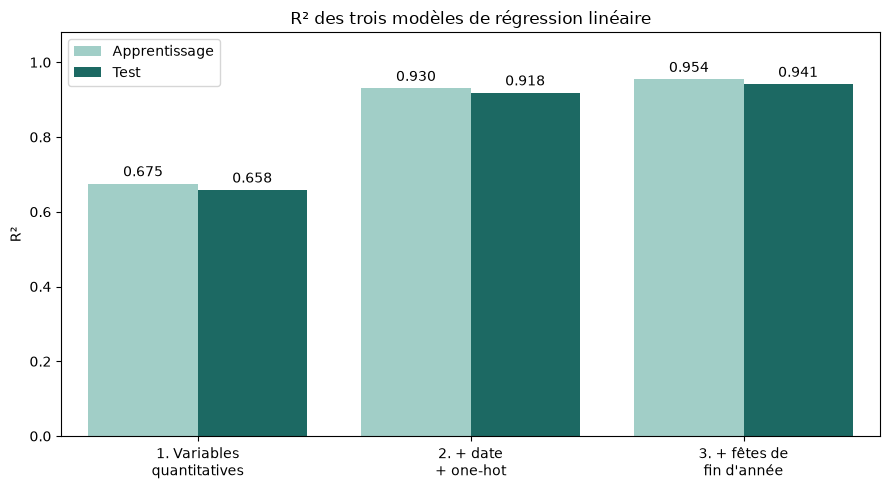
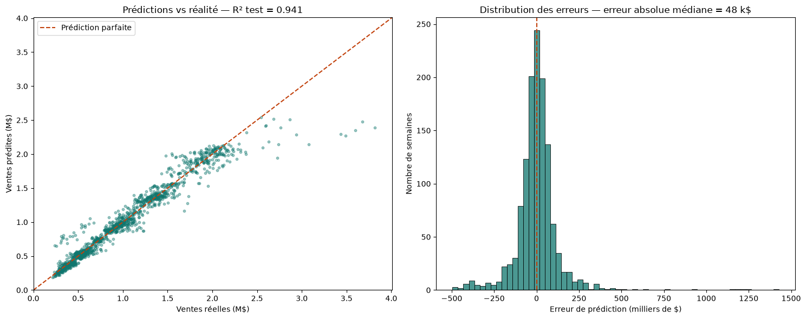
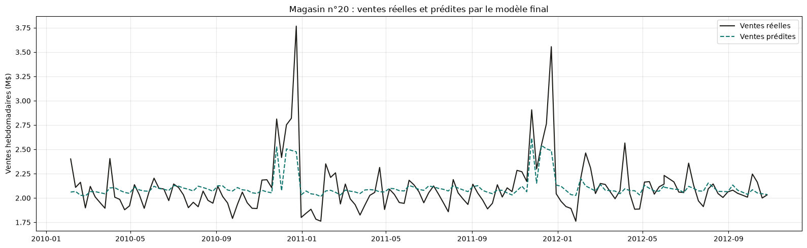
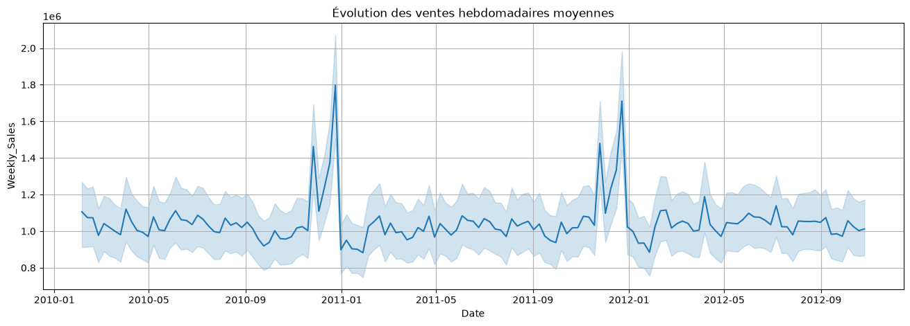
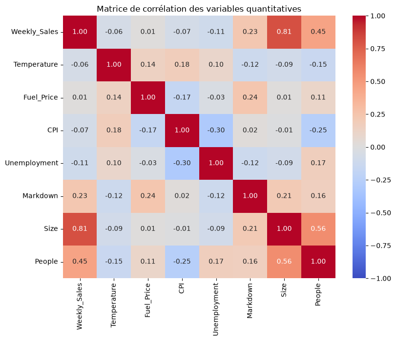
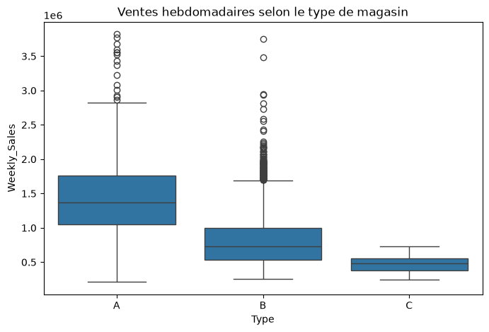
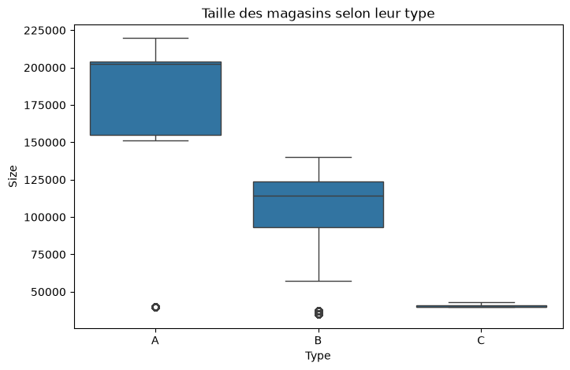
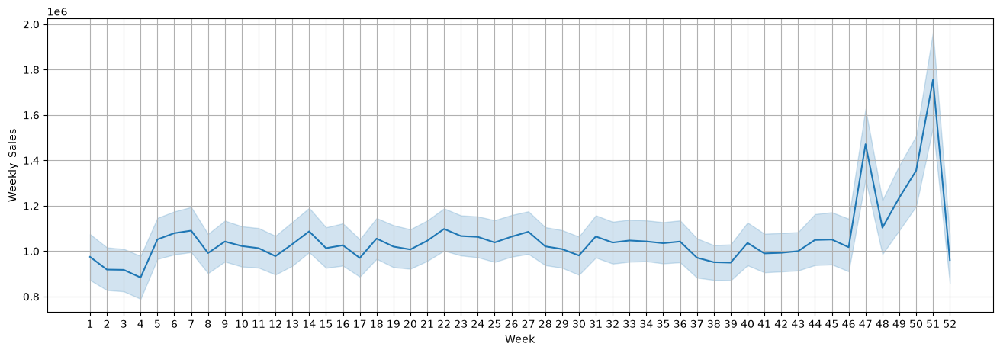

# Prédiction des ventes chez Walmart

Projet personnel de data science : du nettoyage et de la qualité des données jusqu'à la prédiction.
Objectif : prédire les ventes hebdomadaires de 45 magasins Walmart à partir de données économiques, météo et calendaires.
Données issues de la compétition Kaggle
[Walmart Recruiting – Store Sales Forecasting](https://www.kaggle.com/c/walmart-recruiting-store-sales-forecasting).

👉 **Notebook : [walmart_sales_forecasting.ipynb](walmart_sales_forecasting.ipynb)**

## Résultats

| Modèle                                        | R² apprentissage | R² test   |
| --------------------------------------------- | ---------------- | --------- |
| Variables quantitatives seules                | 0,675            | 0,658     |
| + date + one-hot (magasin, type, vacances)    | 0,930            | 0,918     |
| + variable « fêtes de fin d'année »           | **0,954**        | **0,941** |



- La **taille du magasin** est le premier facteur des ventes (corrélation de 0,81).
- L'**identité du magasin** (encodage one-hot) apporte le plus gros gain de performance.
- Une **semaine de fêtes de fin d'année** rapporte en moyenne **+460 000 $** de ventes par magasin.

### Prédictions du modèle final sur la base de test

Les prédictions suivent de près les ventes réelles : l'erreur absolue médiane est de **48 000 $** par semaine,
pour des ventes moyennes d'environ 1 M$.



Sur le plus gros magasin du réseau, le modèle place bien les pics de fin d'année mais en **sous-estime l'ampleur** :
l'effet « fêtes » est appris comme un montant fixe pour tous les magasins, alors qu'il est proportionnel à leur taille.
Une interaction `fêtes × taille`, une cible en logarithme ou un modèle non linéaire sont les prochaines pistes.



## Ce que montrent les données

**Une saisonnalité très marquée :** les ventes sont stables toute l'année, avec deux pics nets à Thanksgiving et avant Noël,
puis un creux en janvier.



**La taille du magasin est le facteur dominant :** elle est fortement corrélée aux ventes (0,81), alors que le chômage, le CPI ou
le prix du carburant n'ont quasiment aucun lien avec elles.



**Le type de magasin reflète sa taille :** les magasins de type A, les plus grands, vendent environ deux fois plus que ceux de type B.

<p align="center">
  
  
</p>

**Les semaines `IsHoliday` n'ont qu'un effet faible (+8 %)**, car elles mélangent des périodes très différentes. D'où la
création d'une variable ciblée sur les semaines 47 et 49 à 51, où les ventes s'envolent :



## Démarche

1. Fusion des tables ventes / magasins (`pd.merge`) et suppression des doublons
2. Contrôle qualité (doublons, types) puis traitement de valeurs manquantes injectées volontairement : `ffill` pour les variables qualitatives, standardisation + `KNNImputer` pour les quantitatives
3. Analyse exploratoire : corrélations, boxplots, évolution temporelle des ventes
4. Encodage de la date et encodage one-hot de `Store`, `Type`, `IsHoliday`
5. Régression linéaire (RSS, RSE, R² apprentissage / test)
6. Feature engineering : variable `End_of_year_holidays` (semaines 47 et 49 à 51)
7. Visualisation des résultats : comparaison des modèles, prédictions contre réalité, analyse des erreurs

## Données

| Fichier          | Contenu                                                                                   |
| ---------------- | ----------------------------------------------------------------------------------------- |
| `data_w.csv`     | Ventes hebdomadaires par magasin + température, carburant, CPI, chômage, vacances, Markdown |
| `stores_w.csv`   | Type, surface et nombre d'employés des 45 magasins                                         |
| `df_w.csv`       | Les deux tables déjà fusionnées (fichier de contrôle)                                       |

## Lancer le notebook

```bash
pip install -r requirements.txt
jupyter notebook walmart_sales_forecasting.ipynb
```

> L'injection de valeurs manquantes écrit des NaN dans une colonne booléenne, ce qui n'est plus autorisé à partir de pandas 3 :
> il faut donc **pandas 2.x** (fixé dans `requirements.txt`).

---

Abibatou WANDAOGO — [Portfolio](https://abibatouwandaogo.github.io/portfolio/projets/data-scientist/walmart-ventes)
